

  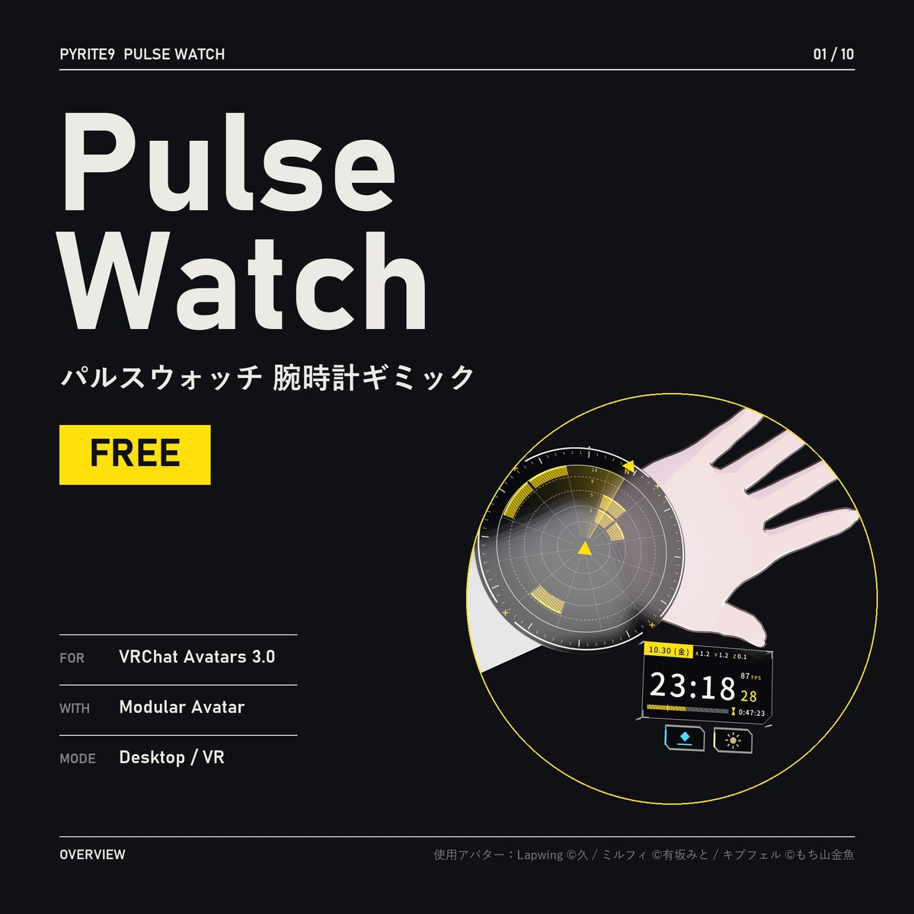

<h1 align="center">Pulse Watch</h1>

  <b>パルスウォッチ 腕時計ギミック</b> · Pop-up wristwatch gimmick for VRChat · VRChat 손목시계 기믹 
  <b>FREE / 無料 / 무료</b> — Modular Avatar · VR / Desktop · PC

  <a href="https://pyrite9.booth.pm/items/9072249"><b>BOOTH</b></a> ·
  <a href="../../releases/latest"><b>Download (Releases)</b></a> ·
  <a href="https://youtu.be/8LORLEosO8A"><b>Video</b></a> ·
  <a href="Assets/Pyrite9/PulseWatch/README_jp.md">日本語</a> ·
  <a href="Assets/Pyrite9/PulseWatch/README_en.md">English</a> ·
  <a href="Assets/Pyrite9/PulseWatch/README_ko.md">한국어</a>

  <a href="https://youtu.be/8LORLEosO8A">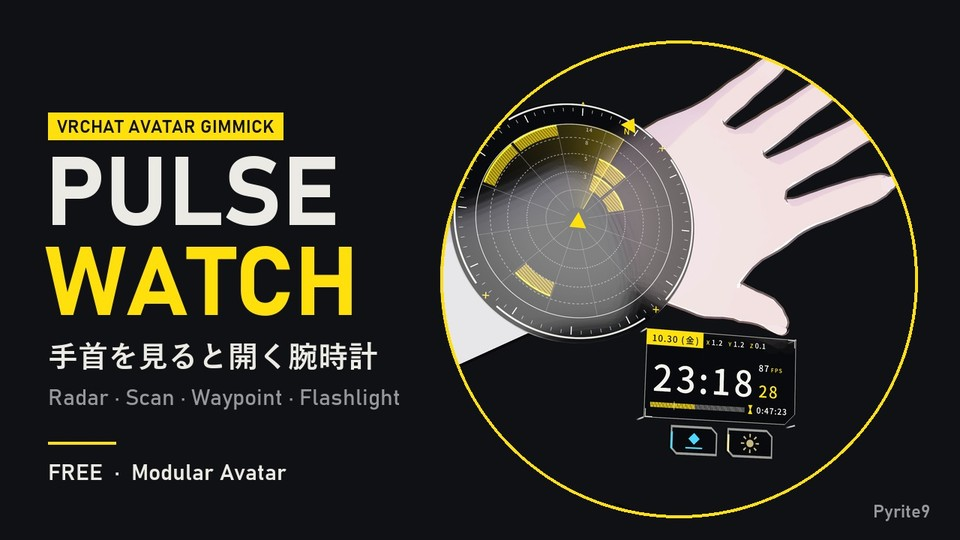</a>

時計を見るように手首を目に向けると、手首の上にホログラムが開きます。手首を目から離すとたたまれます  
Turn your wrist to your eyes as if checking the time and a hologram opens over the watch. Move the wrist away and it folds up.  
손목을 시계 보듯 눈 쪽으로 돌리면 손목 위에 홀로그램이 펼쳐집니다. 손목을 치우면 접힙니다

---

`02 / 10`

## Radar.

14 m までの周りの人を、12 方向 × 5 距離の格子で — 開くとスキャンの波が床・壁・人の上を走る（自分にだけ見える）  
People within 14 m on a 12-direction × 5-distance grid — on opening, a scan wave runs over floors, walls and people (only you see it).  
14 m 안 주변 사람을 12방향 × 5거리 격자로 — 열 때 스캔 파동이 바닥·벽·사람 위를 지나감(나에게만 보임)

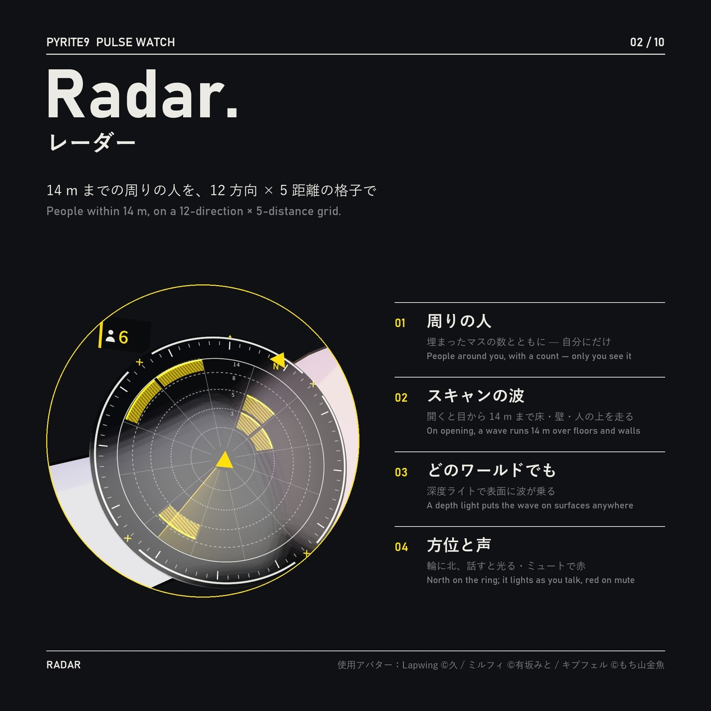

---

`03 / 10`

## Clock.

自分のタイムゾーンの時刻とワールド座標をみんなの画面に、フレームレートは自分にだけ  
Your own time zone and world position on everyone's screen; your frame rate only for you.  
내 시간대 시각과 월드 좌표는 모두에게, 프레임 레이트는 나에게만

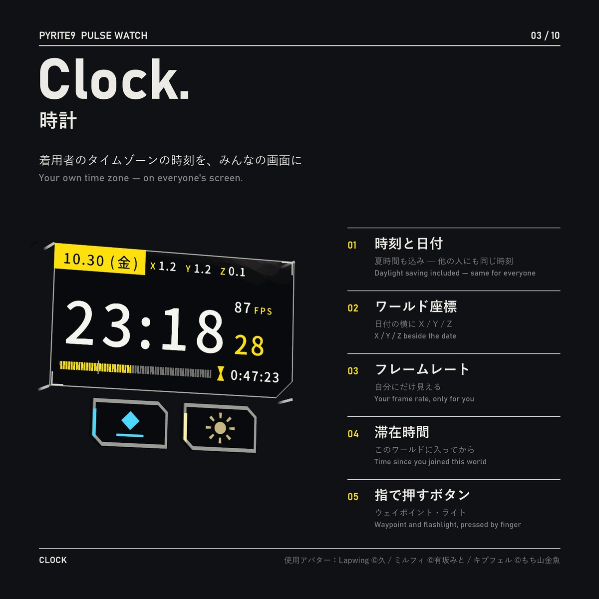

---

`04 – 05 / 10`

## Waypoint. · Flashlight.

反対の手で指さし → 時計のボタンでレーザー → トリガーで印。もう一つのボタンで視線の方へスポットライト  
Point with your other hand, press the button for a laser, pull the trigger to mark a spot. The second button shines a spotlight toward where you look.  
반대 손으로 가리키고 → 시계 버튼으로 레이저 → 트리거로 표지. 버튼 하나 더 누르면 보는 쪽으로 스포트라이트

  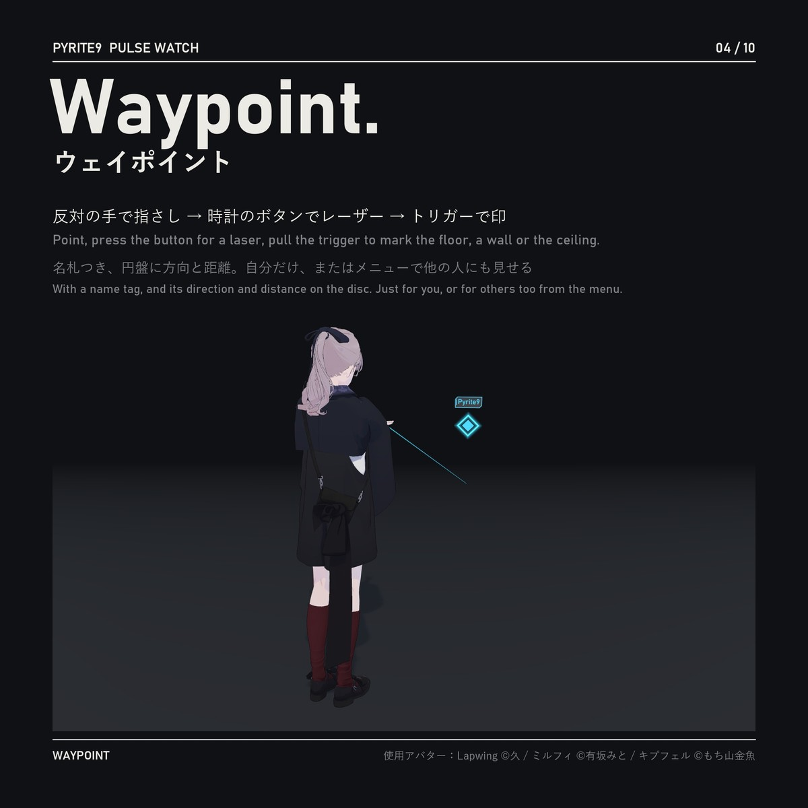
  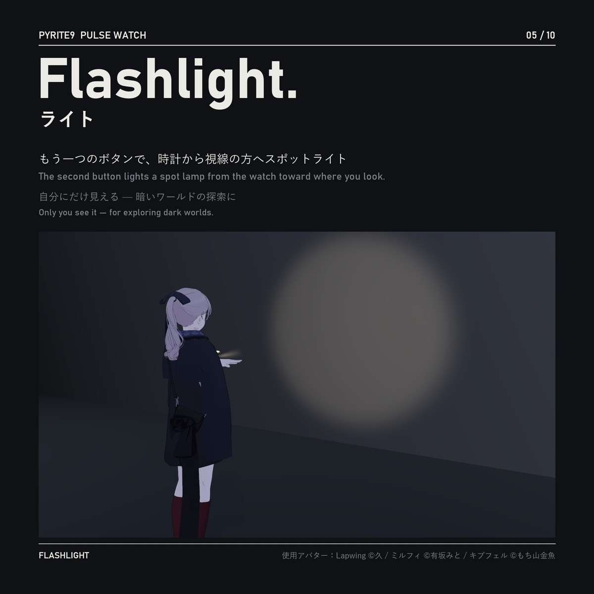

---

`06 – 07 / 10`

## How to use. · Features.

VR：手首を目に向けると開く。デスクトップ：メニューの「開いたままにする」  
VR: turn your wrist to your eyes. Desktop: "Keep open" in the menu.  
VR: 손목을 눈 쪽으로 돌리면 열림. 데스크톱: 메뉴 "계속 열기"

  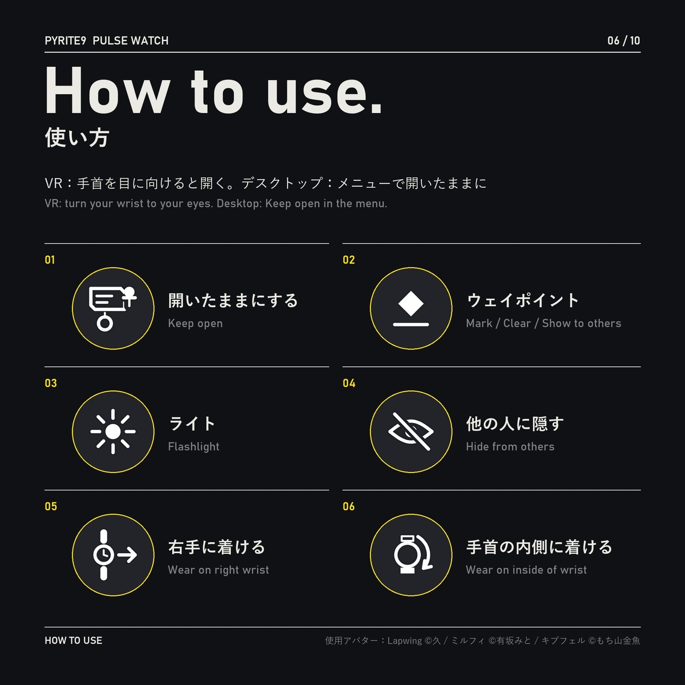
  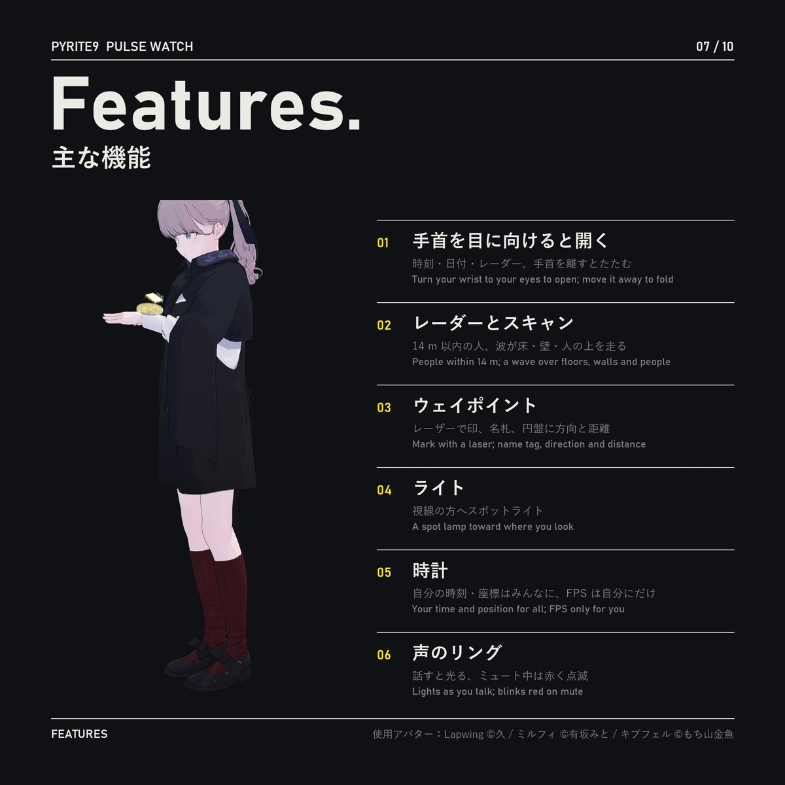

---

`08 – 10 / 10`

## Any avatar. · Inspector. · Specs.

ヒューマノイドのアバターにプレハブを入れるだけ — ビルド時に前腕に合わせて自動調整  
Drop the prefab into any humanoid avatar — it fits the forearm at build time.  
휴머노이드 아바타에 프리팹을 넣기만 하면 — 빌드할 때 팔뚝에 맞춰 자동 조정

  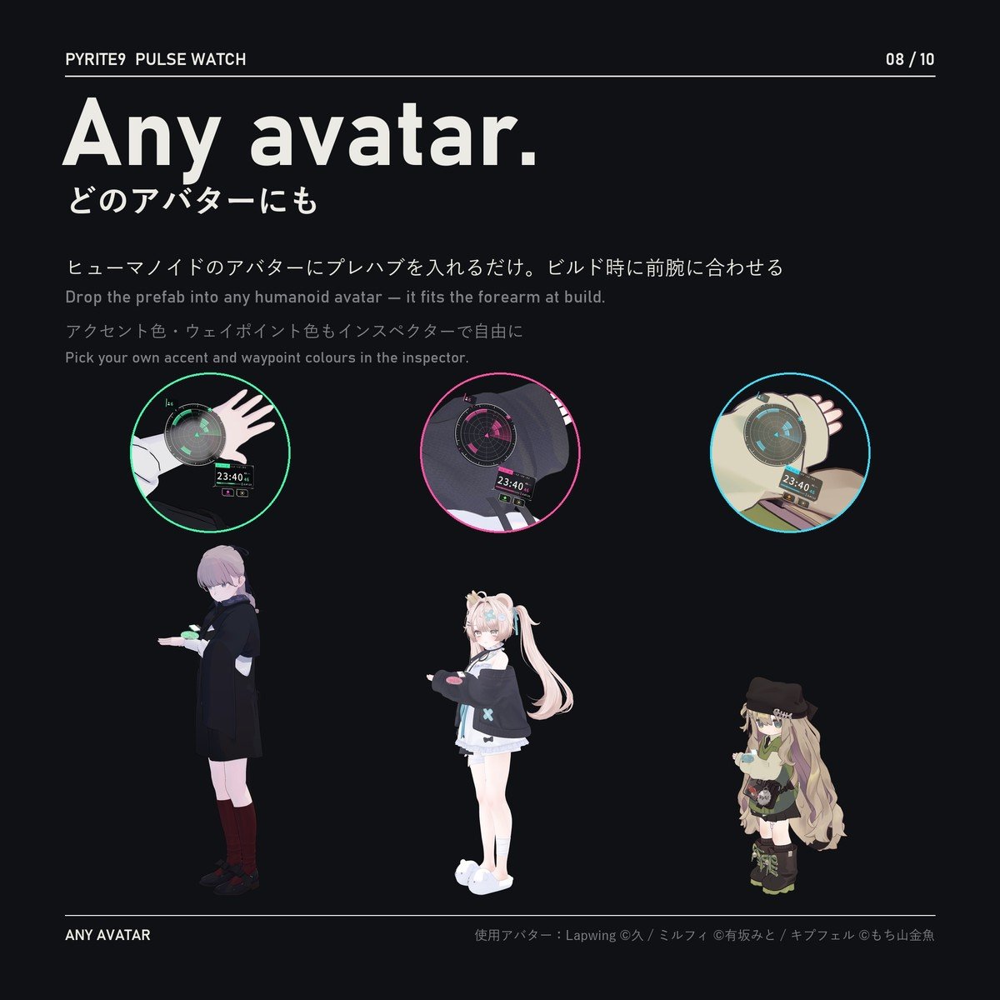
  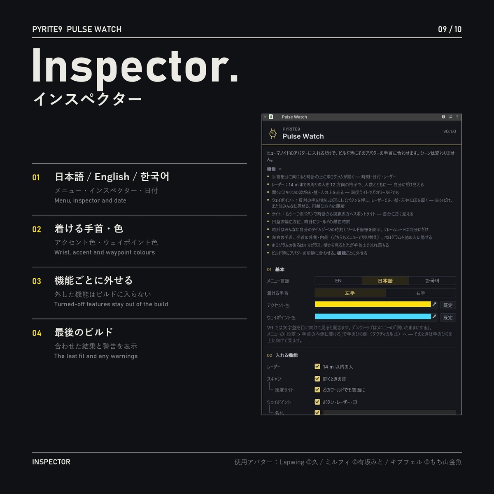

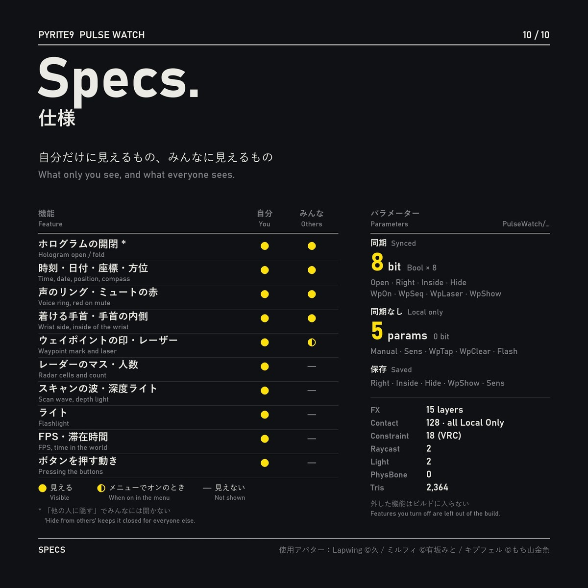

---

## Install. / 導入 / 설치

1. VCC / ALCOM で **Modular Avatar** を追加 · Add Modular Avatar · Modular Avatar 추가
2. `Pyrite9_PulseWatch_v*.unitypackage` をインポート · Import the unitypackage · unitypackage 임포트
   (or copy `Assets/Pyrite9/PulseWatch/` from this repository with the `.meta` files)
3. `Assets/Pyrite9/PulseWatch/PulseWatch.prefab` をアバターの直下へドラッグ · Drag the prefab directly under your avatar · 프리팹을 아바타 바로 아래로 드래그
4. Build & Test → Build & Publish

## Requirements. / 動作環境 / 필요한 것

Unity 2022.3 · VRChat SDK Avatars 3.10+ · Modular Avatar (NDMF) · humanoid avatar · PC only (lilToon not needed)  
Tested: Unity 2022.3.22f1 / VRChat SDK 3.10.5 / Modular Avatar 1.18.7 / NDMF 1.14.8  
Every feature on: 2 lights · Bounds up to 66.8 × 59.8 × 30 m (waypoint laser, scan wave) · 8 synced bits · 15 FX layers · all 128 contacts Local Only. Who sees what and what each feature costs: "Performance" in the README ([EN](Assets/Pyrite9/PulseWatch/README_en.md) · [JP](Assets/Pyrite9/PulseWatch/README_jp.md)「パフォーマンス」 · [KO](Assets/Pyrite9/PulseWatch/README_ko.md) "퍼포먼스")  
The inspector checks GitHub (`api.github.com`) for the latest version once a day; nothing is sent. · インスペクターは 1 日 1 回 GitHub で最新版を確認します（送信する情報はありません）· 인스펙터는 하루 한 번 GitHub에서 최신 버전을 확인합니다(보내는 정보 없음)

## License. / 利用規約 / 라이선스

Free — not an open-source license. See [LICENSE.txt](LICENSE.txt) (English / 日本語 / 한국어).  
Avatars using it (public or private) and monetised videos / streams are fine. Viewing and forking on GitHub are fine; redistributing the files elsewhere is not.  
無料。アバターへの使用・収益化を含む動画/配信 OK。GitHub での閲覧・フォーク可、それ以外での再配布は不可。  
무료. 아바타 사용·수익 창출 포함 영상/방송 OK. GitHub에서 보기·포크 가능, 그 밖의 재배포는 불가.

The glyph texture was rendered from Noto Sans KR (SIL OFL 1.1); no font file is included.

使用アバター（画像）: Lapwing ©久 / ミルフィ ©有坂みと / キプフェル ©もち山金魚

© Pyrite9

